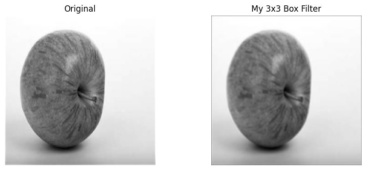
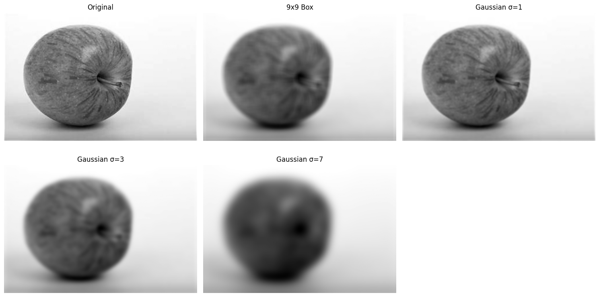
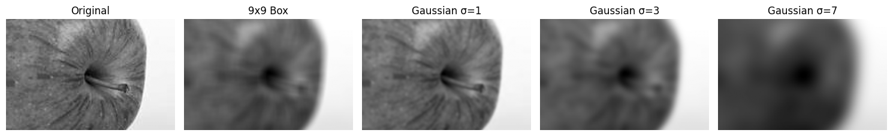
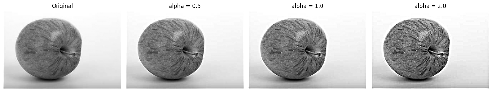
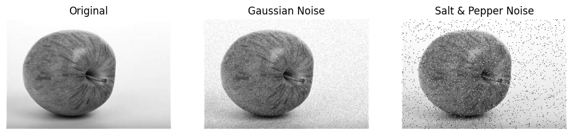
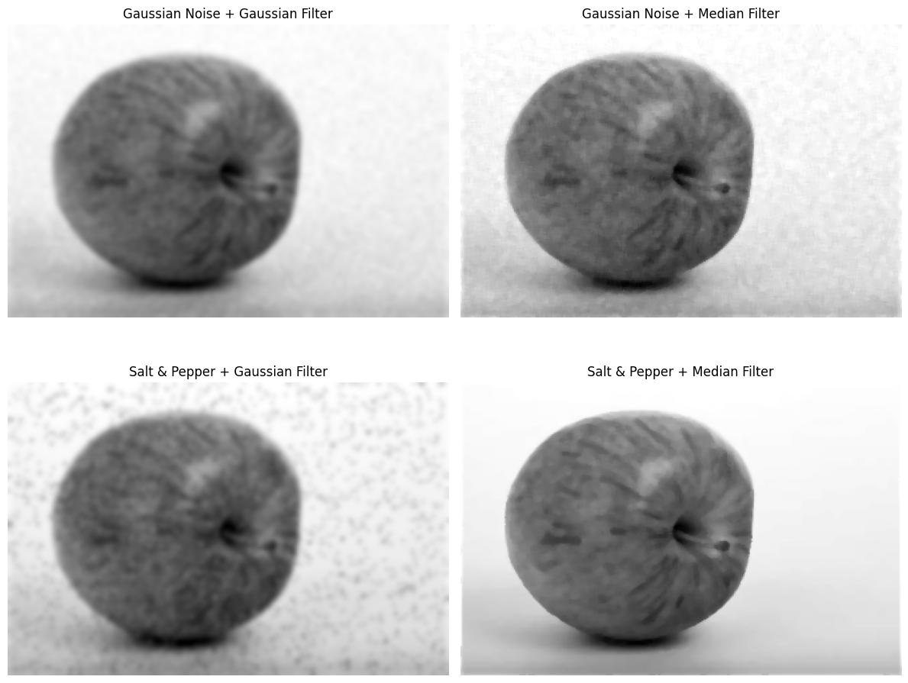

<div align="center">

# 🔍 Blurring & Sharpening from Scratch

### Convolution, Gaussian smoothing, unsharp masking, and noise removal — built and compared against OpenCV.

[](https://colab.research.google.com/github/Ahmed-Mazhar1/Computer-Vision/blob/main/Blurring%20and%20Sharpening.ipynb)


</div>

---

## ✨ Overview

Ever wondered what `cv2.GaussianBlur` is *really* doing? This project opens the black box.

I implemented 2D convolution **from scratch with NumPy**, proved it matches OpenCV's output, then used it as a foundation to explore how blurring, sharpening, and denoising filters behave on a real image.

## 🧪 What's Inside

| Task | What I did | Key idea |
|:----:|------------|----------|
| **1** | Wrote `my_convolve()` from scratch and applied a 3×3 box filter | Padding, kernel flipping, multiply-and-sum |
| **1** | Verified against `cv2.filter2D` | Max absolute difference ≈ `5.7e-14` (floating-point precision) ✅ |
| **2** | Compared a 9×9 box blur with Gaussian blur at σ = 1, 3, 7 | How σ controls the strength of smoothing |
| **2** | Zoomed into cropped regions of each result | Seeing the detail loss up close |
| **3** | Sharpened with **unsharp masking** at α = 0.5, 1.0, 2.0 | `sharp = original + α(original − blur)` |
| **4** | Added **Gaussian** and **salt & pepper** noise | Two very different kinds of corruption |
| **4** | Denoised each with a Gaussian filter and a median filter | Picking the right filter for the right noise |

## 🖼️ Results

### Building convolution from scratch
My own 3×3 box filter produces the same result as OpenCV's.



### Box vs. Gaussian blur
Larger σ means stronger smoothing and less fine detail.



### Zooming in on the details


### Unsharp masking
Increasing α boosts edges and fine texture, but push it too far and noise and halos appear.



### Two kinds of noise


### Which filter wins?


## 💡 Key Takeaways

- **Convolution is just a sliding multiply-and-sum.** Once you've written it yourself, every filter becomes a different kernel.
- **Gaussian blur smooths evenly but also smears.** Salt & pepper specks get spread into soft dark blotches instead of being removed.
- **Median filtering excels at salt & pepper noise.** It discards extreme pixel values entirely, giving a much cleaner result while keeping edges sharper.
- **Sharpening is blur in reverse.** Subtracting a blurred copy isolates the edges, and α controls how much gets added back.

## ⚡ Run It Yourself

**Option 1: Google Colab (easiest).** Click the badge at the top, upload an image as `photo.jpg` to the Colab files panel (`/content/photo.jpg`), then run all cells.

**Option 2: Locally**

```bash
git clone https://github.com/Ahmed-Mazhar1/Computer-Vision.git
cd Computer-Vision
pip install opencv-python numpy matplotlib jupyter
jupyter notebook "Blurring and Sharpening.ipynb"
```

> 📌 The notebook reads `/content/photo.jpg`. If running locally, change that path in the first code cell to point to your own image.

## 🗺️ Roadmap

- [x] Convolution from scratch
- [x] Blurring, sharpening, and noise removal
- [ ] Edge detection (Sobel, Canny)
- [ ] Morphological operations
- [ ] Feature detection and matching
- [ ] Real-time video processing

## 📬 Connect

[](https://github.com/Ahmed-Mazhar1)

---

<div align="center">

⭐ **Found this useful? Drop a star!** ⭐

</div>
