<div align="center">

# 🔍 Computer Vision Labs

**Core computer vision techniques implemented step by step with NumPy and OpenCV: filtering, pyramids, frequency analysis, edge detection, and Hough transforms.**

Coursework for Computer Vision (CSE381) at MSA University.

[](https://www.python.org/)
[](https://opencv.org/)
[](https://numpy.org/)
[](https://matplotlib.org/)
[](https://jupyter.org/)

</div>

---

## 📑 Table of Contents

- [Overview](#-overview)
- [Notebooks](#-notebooks)
- [Lab: Blurring & Sharpening](#-lab-blurring--sharpening-from-scratch)
- [Lab 3: Image Pyramids & Frequency-Domain Filtering](#-lab-3-image-pyramids--frequency-domain-filtering)
- [Lab 4: Hybrid Images, Edges & Hough Transforms](#-lab-4-hybrid-images-edges--hough-transforms)
- [Repository Structure](#-repository-structure)
- [Getting Started](#-getting-started)
- [Roadmap](#-roadmap)
- [Author](#-author)

---

## ✨ Overview

This repository collects my labs for the Computer Vision course. Wherever possible I build the core operation myself, check it against OpenCV, and then use it to see how the technique behaves on real images.

## 📓 Notebooks

| Notebook | Topic | Colab |
| --- | --- | --- |
| [`Blurring and Sharpening.ipynb`](Blurring%20and%20Sharpening.ipynb) | Convolution from scratch, box vs. Gaussian blur, unsharp masking, noise removal | [](https://colab.research.google.com/github/Ahmed-Mazhar1/Computer-Vision/blob/main/Blurring%20and%20Sharpening.ipynb) |
| [`Lab3.ipynb`](Lab3.ipynb) | Gaussian & Laplacian pyramids, FFT spectra, frequency-domain low/high-pass filtering | [](https://colab.research.google.com/github/Ahmed-Mazhar1/Computer-Vision/blob/main/Lab3.ipynb) |
| [`Lab4.ipynb`](Lab4.ipynb) | Hybrid images, Canny edges, Hough lines & circles, lane detection | [](https://colab.research.google.com/github/Ahmed-Mazhar1/Computer-Vision/blob/main/Lab4.ipynb) |

---

## 🧪 Lab: Blurring & Sharpening from Scratch

> Convolution, Gaussian smoothing, unsharp masking, and noise removal, built and compared against OpenCV.

Ever wondered what `cv2.GaussianBlur` is *really* doing? This lab opens the black box. I implemented 2D convolution **from scratch with NumPy**, verified it matches OpenCV's output, then used it as a foundation to explore how blurring, sharpening, and denoising filters behave on a real image.

### What's Inside

| Task | What I did | Key idea |
| ---- | ---------- | -------- |
| **1** | Wrote `my_convolve()` from scratch and applied a 3×3 box filter | Padding, kernel flipping, multiply-and-sum |
| **1** | Verified against `cv2.filter2D` | Max absolute difference ≈ `5.7e-14` (floating-point precision) ✅ |
| **2** | Compared a 9×9 box blur with Gaussian blur at σ = 1, 3, 7 | How σ controls the strength of smoothing |
| **2** | Zoomed into cropped regions of each result | Seeing the detail loss up close |
| **3** | Sharpened with **unsharp masking** at α = 0.5, 1.0, 2.0 | `sharp = original + α(original − blur)` |
| **4** | Added **Gaussian** and **salt & pepper** noise | Two very different kinds of corruption |
| **4** | Denoised each with a Gaussian filter and a median filter | Picking the right filter for the right noise |

### Results

**Convolution from scratch.** My own 3×3 box filter produces the same result as OpenCV's.

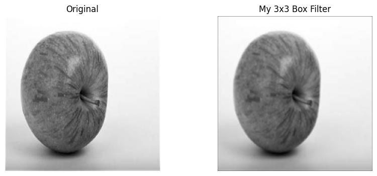

**Box vs. Gaussian blur.** Larger σ means stronger smoothing and less fine detail.

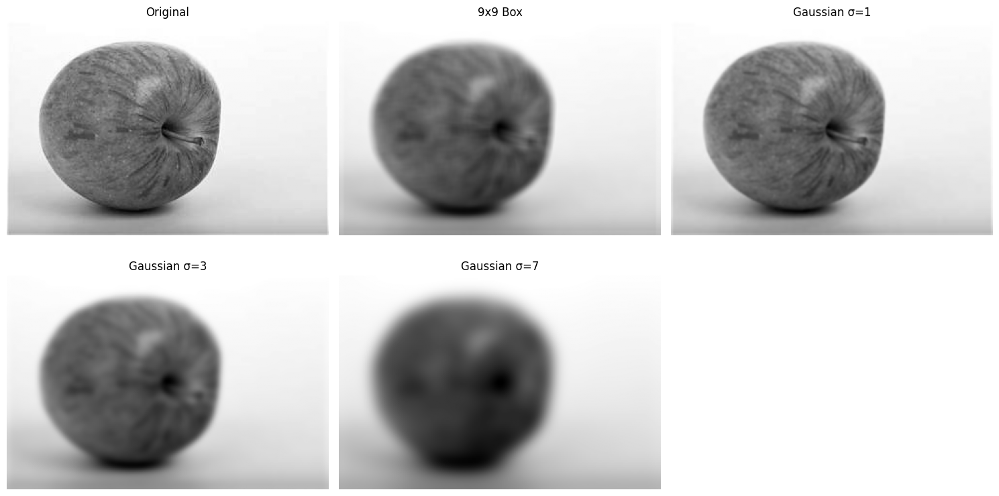

**Zooming in on the details.**

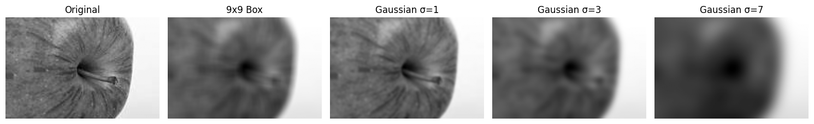

**Unsharp masking.** Increasing α boosts edges and fine texture, but push it too far and noise and halos appear.

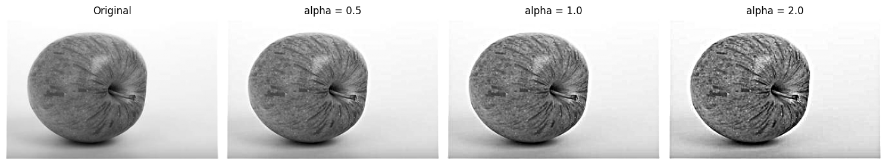

**Two kinds of noise.**

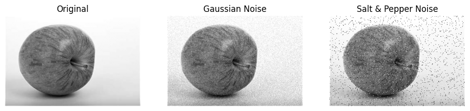

**Which filter wins?**

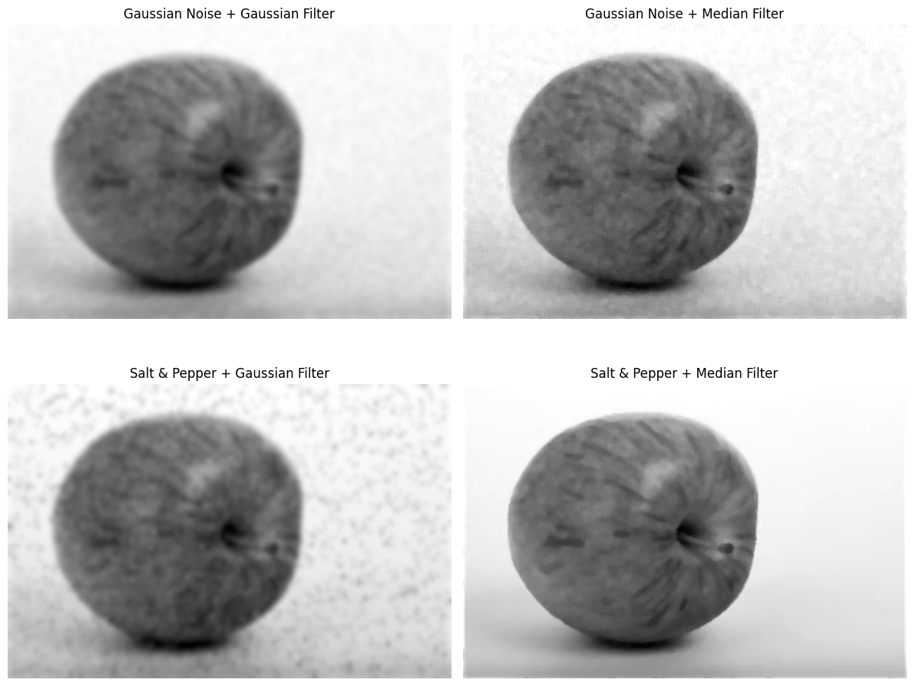

### Key Takeaways

- **Convolution is just a sliding multiply-and-sum.** Once you've written it yourself, every filter becomes a different kernel.
- **Gaussian blur smooths evenly but also smears.** Salt & pepper specks get spread into soft dark blotches instead of being removed.
- **Median filtering excels at salt & pepper noise.** It discards extreme pixel values entirely, giving a much cleaner result while keeping edges sharper.
- **Sharpening is blur in reverse.** Subtracting a blurred copy isolates the edges, and α controls how much gets added back.

---

## 🧪 Lab 3: Image Pyramids & Frequency-Domain Filtering

> Multi-scale image representations and the Fourier view of an image.

This lab looks at an image at several scales and in the frequency domain. I built Gaussian and Laplacian pyramids, reconstructed the original image from the Laplacian pyramid, studied the Fourier spectra of different image types, and applied ideal low-pass and high-pass filters directly on the spectrum.

### What's Inside

| Task | What I did | Key idea |
| ---- | ---------- | -------- |
| **1** | Built a 5-level **Gaussian pyramid** with `cv2.pyrDown` (1168×1184 → 73×74) | Smooth, then downsample at each level |
| **2** | Wrote `laplacian_pyramid()` and `reconstruct()` | `Lᵢ = Gᵢ − pyrUp(Gᵢ₊₁)`, and `Gᵢ = Lᵢ + pyrUp(Gᵢ₊₁)` |
| **2** | Reconstructed the original from the Laplacian pyramid | Maximum absolute error = `0.0` ✅ |
| **3** | Compared FFT spectra of a natural scene, a regular texture, and a synthetic vertical edge | Spectrum = `20·log(\|F\| + 1)`, shifted so low frequencies sit at the center |
| **4** | Wrote `circular_masks()` and `frequency_filter()` and applied them at radius 20 and 60 | Mask the shifted spectrum, then inverse-transform |

### Results

**Gaussian pyramid** (drawn at true relative sizes).

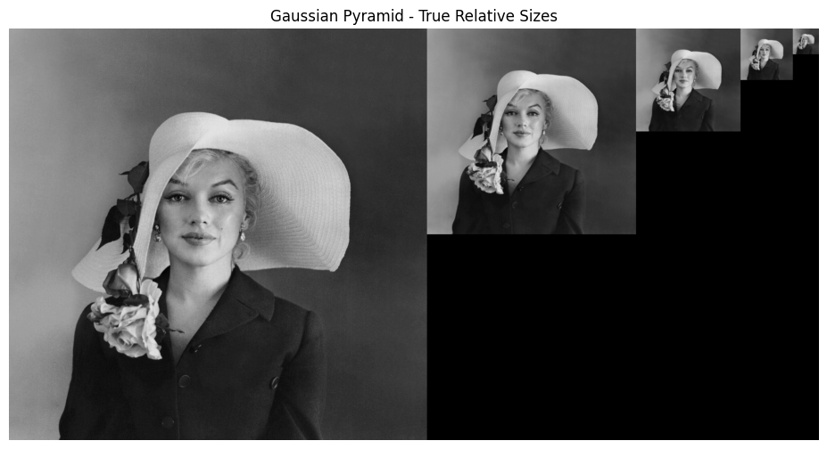

**Laplacian pyramid.** Each level holds the detail lost between two Gaussian levels (red = positive, blue = negative); the last level is the smallest Gaussian image.

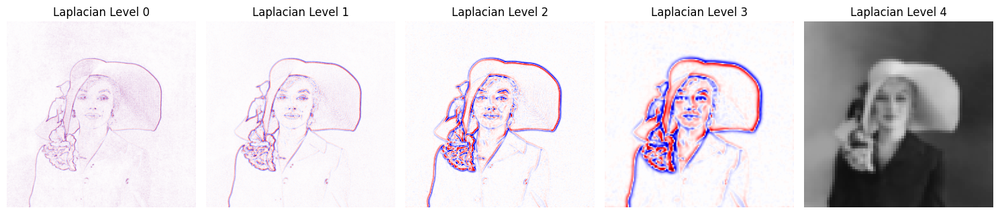

**Perfect reconstruction.** Original, reconstruction, and their absolute difference.

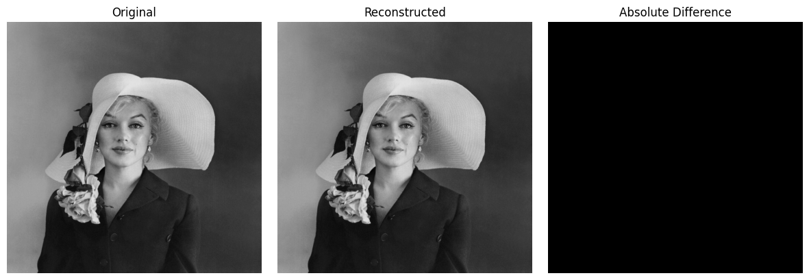

**FFT spectra.** Natural scene, regular texture, and vertical edge.

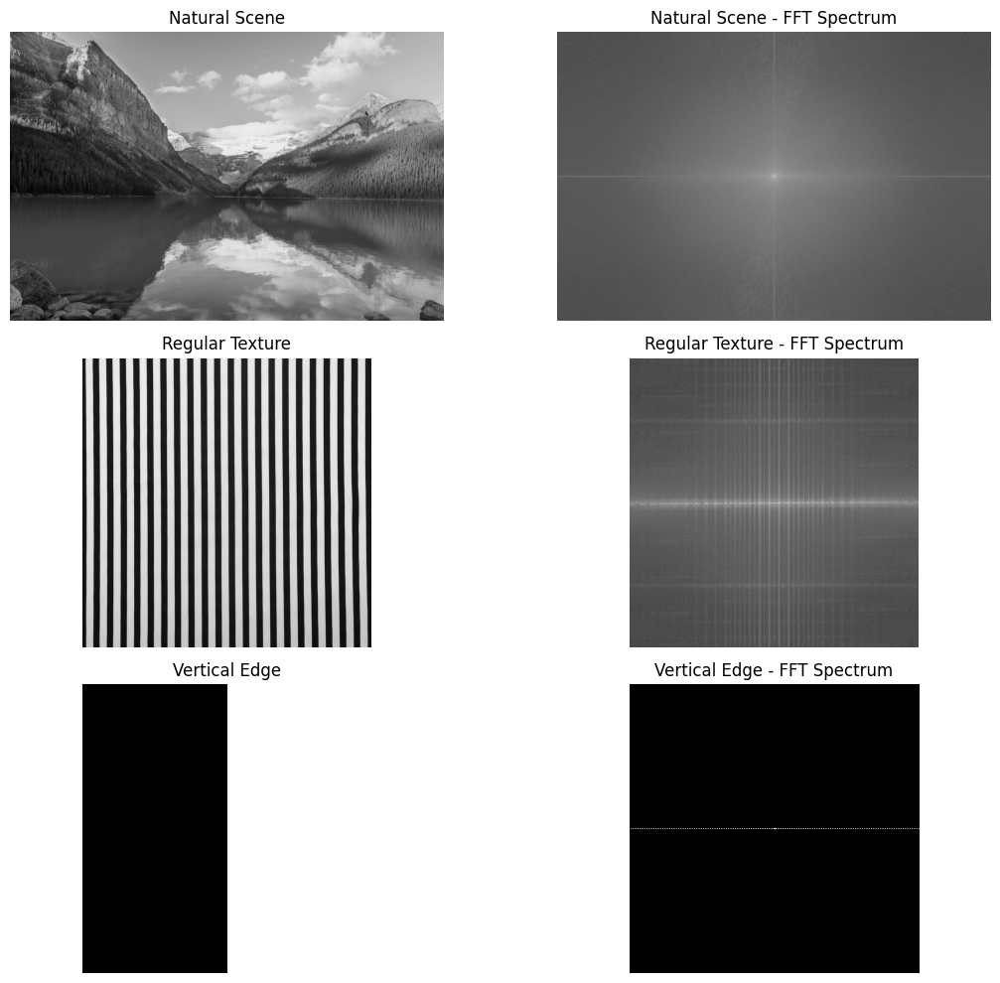

**Frequency-domain filtering.** Low-pass result, high-pass result, and the mask, for radius 20 and 60.

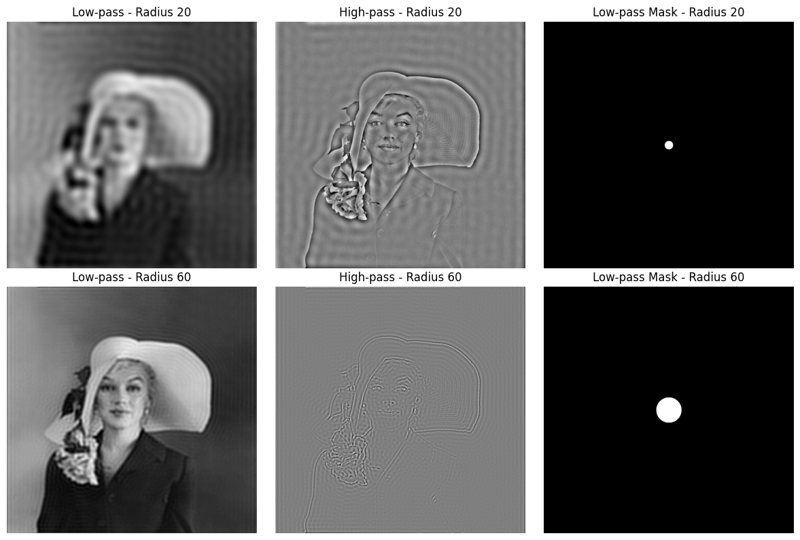

### Key Takeaways

- **Laplacian levels store the details that Gaussian downsampling throws away**, such as edges and textures at different scales. Expanding the smallest Gaussian level and adding those details back reproduces the original exactly.
- **Natural scenes concentrate energy near the center of the spectrum**, because smooth regions and large structures are low spatial frequencies.
- **Regular textures produce distinct peaks**, since repeating patterns correspond to specific spatial frequencies.
- **A vertical edge shows up as energy along the horizontal frequency axis**, because intensity changes across the edge, perpendicular to its orientation.
- **Ideal low-pass filtering is similar in spirit to Gaussian blur**, since spatial convolution corresponds to frequency-domain multiplication. The sharp circular cutoff can introduce ringing artifacts, unlike a Gaussian's smooth frequency response.

---

## 🧪 Lab 4: Hybrid Images, Edges & Hough Transforms

> From low/high-frequency blending to detecting lines, circles, and road lanes.

This lab starts with hybrid images and then moves into edge detection and shape detection: Canny edges, the Hough transform for lines and circles, and finally a complete lane-detection pipeline on road images.

### What's Inside

| Task | What I did | Key idea |
| ---- | ---------- | -------- |
| **Hybrid** | Combined a Gaussian low-pass of image A (σ = 12) with a high-pass of image B (`B − blur(B)`, σ = 15) | Close up you see B's detail, from far away you see A |
| **1** | Ran Canny on a road image with threshold pairs (10, 50), (50, 150), (150, 250), and with Gaussian pre-blur at σ = 1 and 3 | Thresholds trade missed faint edges against noise |
| **2** | Detected lines on a shape image with Canny + `cv2.HoughLines`, then drew them from (ρ, θ) | `ρ = x·cosθ + y·sinθ` |
| **3** | Detected coins with `cv2.HoughCircles` (9×9 blur, `minDist=40`, `param1=120`, `param2=35`, radius 15–60) | Voting in circle-parameter space |
| **4** | Built `detect_lanes()`: grayscale + blur → Canny → region of interest → `cv2.HoughLinesP` → split by slope and position → average into left/right lanes | Chaining classical techniques into a pipeline |

### Results

**Hybrid image.** Close view (left) and far view (right).

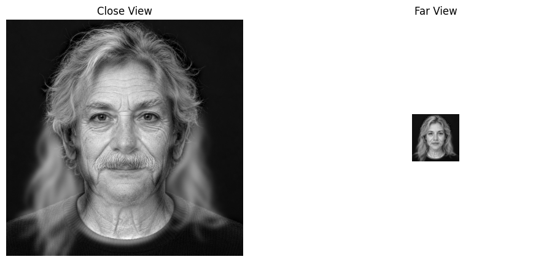

**Canny with different thresholds** (10–50, 50–150, 150–250).

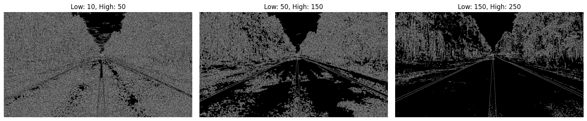

**Hough lines.**

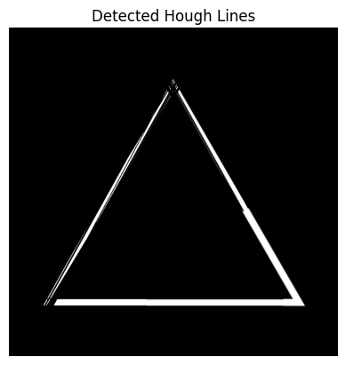

**Hough circles.** The coin image with the chosen parameters gave 58 detected circles.

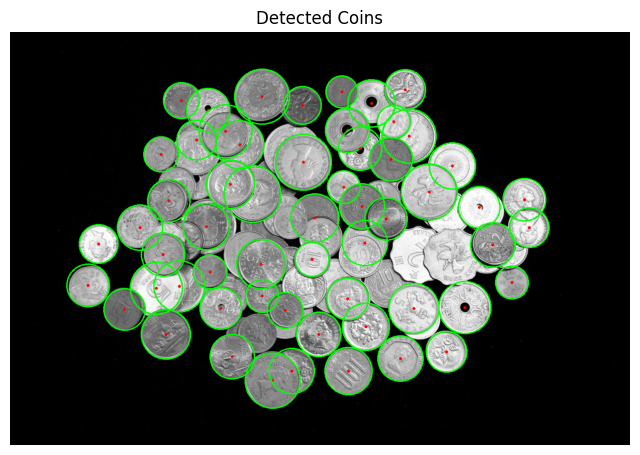

**Lane detection pipeline.** Region-of-interest mask on the first road image, then results on all three roads.

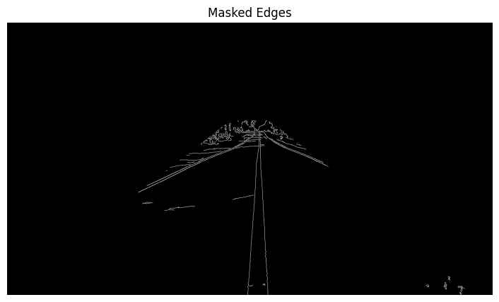

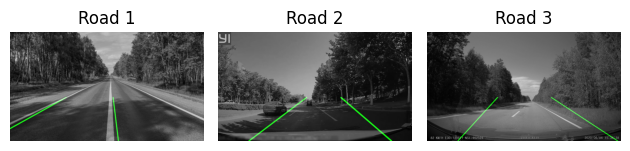

### Key Takeaways

- **Canny thresholds control the trade-off between completeness and noise.** Low thresholds pick up weak lane markings along with trees and noise; high thresholds suppress noise but can drop faint markings. Pre-blurring with a larger σ removes small details before edge detection.
- **A Hough line is just a (ρ, θ) pair.** For example `ρ = 1017, θ = 90°` means `y = 1017`, and points such as (500, 1017) and (800, 1017) satisfy it.
- **`param2` guards against false circles, `minDist` against duplicates.** Lowering `param2` accepts weaker votes and adds incorrect circles; lowering `minDist` lets several circles land on the same coin.
- **Lane detection is a pipeline, not one algorithm.** Blurring, Canny, a region-of-interest mask, probabilistic Hough, and slope-based filtering each remove a different kind of error.

---

## 📁 Repository Structure

```
Computer-Vision/
├── assets/                          # Result images used in this README
├── Blurring and Sharpening.ipynb    # Convolution, blur, sharpen, denoise
├── Lab3.ipynb                       # Pyramids, FFT, frequency filtering
├── Lab4.ipynb                       # Hybrid images, Canny, Hough, lane detection
└── README.md
```

## ⚡ Getting Started

**Prerequisites:** Python 3.9+

### Option 1: Google Colab (easiest)

1. Click an **Open In Colab** badge above.
2. Upload the notebook's input images to the Colab files panel (see the table below).
3. Run all cells.

### Option 2: Run locally

```bash
git clone https://github.com/Ahmed-Mazhar1/Computer-Vision.git
cd Computer-Vision
pip install opencv-python numpy matplotlib jupyter
jupyter notebook
```

### Input images

The notebooks read images from disk, so add your own with these names (or edit the paths in the code cells). Colab notebooks use `/content/`; locally, point the paths at your own folder.

| Notebook | Files expected |
| --- | --- |
| Blurring and Sharpening | `photo.jpg` |
| Lab 3 | `face1.jpg`, `face2.jpg`, `nature.jpg`, `texture.jpg` |
| Lab 4 | `f1.png`, `f2.png`, `shape.jpg`, `coins.jpg`, `road1.jpg`, `road2.jpg`, `road3.jpg` |

## 🗺️ Roadmap

- [x] Convolution from scratch
- [x] Blurring, sharpening, and noise removal
- [x] Gaussian and Laplacian pyramids
- [x] Frequency-domain analysis and filtering
- [x] Canny edge detection
- [x] Hough transform for lines and circles, and lane detection
- [ ] Morphological operations
- [ ] Feature detection and matching

## 👤 Author

**Ahmed Hossam Mohamed.** — Computer Systems Engineering student at MSA University.

[](https://github.com/Ahmed-Mazhar1)

---

<div align="center">

⭐ **Found this useful? Drop a star!** ⭐

</div>
